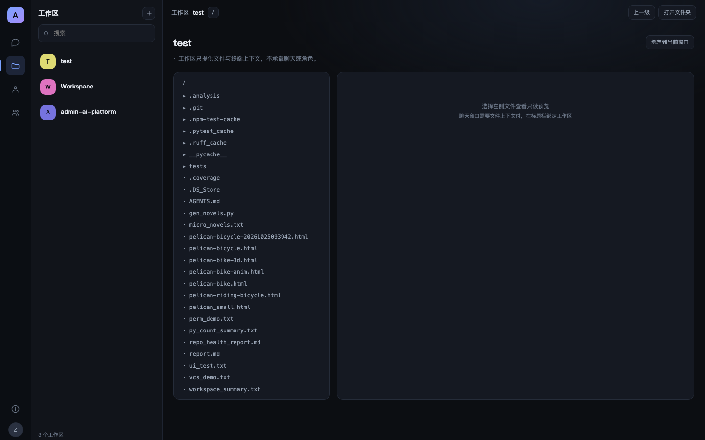
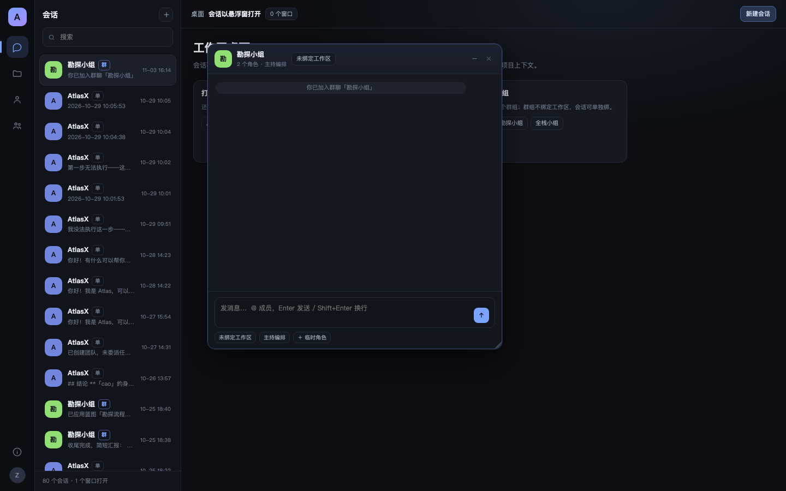
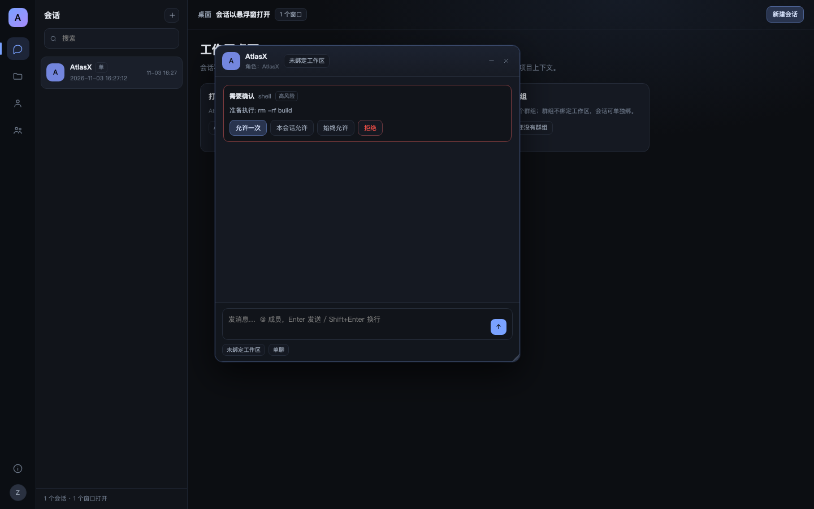
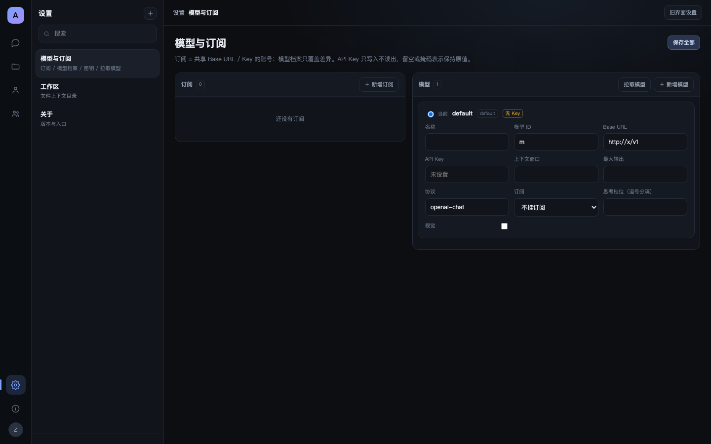

# AtlasX V3.2 · 界面重构（工作区 / 角色 / 群组独立 + 悬浮窗）

> 状态：**已被 3.3 取代**（旧界面与旧数据已退场，见 V4 文档）
>
> 原状态：**核心完成**（2026-11-03）：新壳已是默认入口，3.2.0 DMG 已打包；旧界面 `/classic` 仅兜底未迁移的设置类功能。
> 线框：[`mockups/atlasx-v3/index.html`](mockups/atlasx-v3/index.html)
> 默认入口：`/`（新壳）；旧界面保留在 `/classic`，未迁移的设置类功能可暂时用它。

## 1. 已确认的信息架构

1. **工作区就是工作区**：只提供文件、终端、项目上下文；不再拥有角色，也不承载聊天。
2. **角色就是角色**：独立角色库；持久角色跨会话，临时角色只属于一个会话；LLM 可在对话中创建。
3. **群组就是群组**：一组角色 + 协作方式；**不绑定工作区**，工作区只绑定到会话。
4. **对话 = 应用内多悬浮窗**：主界面不常驻聊天栏，窗口可多开、拖动、缩放、最小化。

## 2. 本轮已落地

### 数据模型（增量迁移，不重建表）

| 表 | 变更 |
| --- | --- |
| `roles` | 新增 `scope`（persistent/temporary）、`source`（user/llm）、`session_id`（临时角色归属） |
| `conversations` | 新增 `bound_workspace_id`（会话级工作区绑定，可空 = 纯聊天）；`workspace_id` 保留为历史容器 |
| `agent_teams` | `workspace_id` 降级为“历史来源”，不再参与可见性/路由；列表可全局返回 |

### API

| 接口 | 说明 |
| --- | --- |
| `GET /roles` | 角色库（默认只返回持久角色；带 `session_id` 可含该会话临时角色） |
| `POST /roles` | 新建角色（`tools` 走能力包络过滤） |
| `PATCH /roles/{id}` | 编辑角色 |
| `DELETE /roles/{id}` | 删除角色（默认角色受保护） |
| `POST /roles/{id}/promote` | 临时角色 → 持久角色 |
| `GET /teams` | 不传 `workspace_id` = 全部群组 |
| `POST /teams` | 可不传 `workspace_id`（群组独立） |
| `PATCH /conversations/{id}/workspace` | 会话级绑定 / 解绑工作区 |

- 删除会话时自动清理 `scope='temporary'` 且 `session_id` 指向该会话的角色。
- `team_for_conv` 不再要求群组与会话同工作区。

### 新前端 `/v3`

- 左轨四个空间：会话 / 工作区 / 角色 / 群组（+ 关于）。
- 会话列表打开**悬浮窗**：多开、拖动、缩放、最小化到 dock、位置记忆。
- 窗口历史消息渲染：用户/助手/系统消息、工具行、任务卡；标题按群名 / 角色名解析（不再用首条消息）。
- 发送消息 + SSE 流（delta / tool_call / tool_result / todo_update / error / run_end）。
- **审批卡**：危险工具在会话内确认（允许一次 / 本会话 / 始终 / 拒绝）；重连时拉取 pending。
- **提问卡**：`ask_user` 的选项 / 自由回答 / 跳过。
- **停止**：运行中可停止当前 run。
- **模型 / 权限**：会话级模型选择（写回 `/preferences`）、权限档位（询问 / 自动执行）。
- **队列条**：运行中继续发消息会排队；支持上移 / 下移 / 取消，跑完自动接上。
- **斜杠命令**：输入 `/` 列出工作区命令，插入后由后端展开。
- **窗口管理**：平铺窗口 / 全部最小化；窄屏（<760px）悬浮窗铺满视口。
- **设置页（新壳内置）**：模型与订阅两栏（新增 / 删除 / 挂订阅 / 拉取模型 / 激活）、工作区、关于；密钥只写入不读出。
- **附件**：粘贴 / 选择文件（≤25MB × 8），随消息发送；图片缩略、文件下载链接。
- **思考档位**：模型支持时在输入区切换，随会话保存并随消息发送。
- 轻量 Markdown：代码块 / 行内代码 / 标题 / 粗体 / 列表（先转义再渲染）。
- `@成员` 补全：按当前会话的群成员过滤、↑↓ / Enter / Tab 选择。
- 会话内**创建临时角色**：写入角色库（scope=temporary + session_id）并加入当前群。
- **LLM 创建角色**：新增 `role_manage` 工具（list / create / update / promote / delete），模型可在对话里创建临时角色并自动入群；界面收到 `role_update` 后刷新角色库。
- 角色库：列表、新建、编辑、单聊、存为持久、删除。
- 群组：列表、新建、编辑成员与协作方式、打开群聊。
- **工作区画布**：目录浏览、上一级、只读文件预览、把工作区绑定到当前窗口。
- 会话标题栏可绑定 / 解绑工作区。

## 3. 尚未迁移（下一阶段）

- 工作区画布：终端入口、文件搜索、写文件（当前只读）。
- 聊天细节：富文本 / 代码高亮、粘贴图片直接入附件。
- LLM 创建角色的确认卡（当前直接入群，后续可加确认）。
- 设置 / 订阅 / MCP / 技能等旧界面功能。
- 全局搜索、窗口平铺 / 全部最小化、窄屏退化为单窗口。
- 设置 / MCP / 技能等旧界面功能迁移完成后，移除 `/classic`。

## 4. 截图









## 5. 打开方式

```bash
# 开发态（沿用现有服务）
.venv/bin/python services/agent_zero/main-agent-zero.py
# 浏览器打开 http://127.0.0.1:10210/v3/
```

桌面端打开 `/` 即为新壳；`/classic` 仅作为未迁移功能的兜底。
